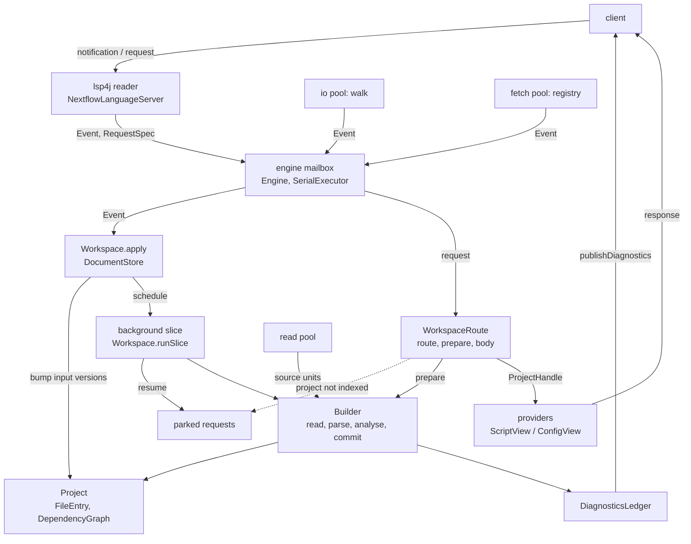

# Internals

How the language server is organized, for contributors: the packages, the threads, the path of a message from the client to a response, and the rules that the engine relies on. Terms are defined in the [glossary](../GLOSSARY.md). The design decision behind the engine is in [ADR 20261023](adr/20261023-language-service-core.md).

## Modules and packages

```text
nextflow.lsp/
├── NextflowLanguageServer     # lsp4j adapter: each notification → Event, each request → RequestSpec + body
├── ClientUris                 # client URI ↔ canonical URI, at the boundary of requests and responses
├── AotTraining                # training workload for the AOT cache, run by the bundle launcher
├── engine/                    # the single-threaded core; everything is engine-confined unless noted
│   ├── Engine                 # mailbox, request dispatch, parking, background scheduling
│   ├── SerialExecutor         # one logical thread with timers; ThreadSerialExecutor ("nextflow-engine")
│   ├── EngineEnvironment      # threads, clock, FileAccess, registry client, exiter; DefaultEngineEnvironment
│   ├── EngineState            # what the engine drives; implemented by Workspace
│   ├── Event, RequestSpec, Need, RequestContext   # engine inputs and what a request body sees
│   ├── DocumentStore          # open documents
│   ├── Workspace              # folders + default project, routing, event handling, slices, progress
│   ├── WorkspaceRoute         # builds what a request needs, creates its context
│   ├── Project                # entries of one workspace folder, its two compilers, freshness queries
│   ├── FileEntry              # build state of one file
│   ├── DependencyGraph        # reverse dependency index; transitive dependents; strongly connected components
│   ├── Builder                # rebuilds a dependency-closed batch from text
│   ├── DiagnosticsLedger      # last published diagnostics per URI; publishes only differences
│   ├── IndexProgress          # work-done progress "Indexing"
│   ├── PluginSpecs            # per-registry cache of plugin specs; PluginRegistryClient, LocalPluginRegistryClient, HttpPluginRegistryClient
│   ├── ProjectHandle          # ProjectView of a request; ScriptEntryView, ConfigEntryView
│   └── FileKind, FileAccess, Uris, Settings   # file kinds, injectable I/O, canonical URIs, settings parsing
├── ast/                       # read-only views for providers (ProjectView, AstView, ScriptView, ConfigView), AST helpers
├── compiler/                  # LanguageServerCompiler: nf-lang compiler for scripts (lib/ on the classpath) and configs
├── services/                  # provider interfaces, LanguageServerConfiguration, ErrorReportingMode
│   ├── script/                # Script*Provider, preview providers, and the script analysis visitors that Builder runs
│   │   └── dag/               # DataflowVisitor → Graph → MermaidRenderer, for the DAG preview
│   └── config/                # Config*Provider, and the config analysis visitors that Builder runs
├── spec/                      # PluginRef, PluginSpec; ConfigSpecFactory, ScriptSpecFactory
└── util/                      # Includes, JsonUtils, LanguageServerUtils, Logger, Positions
```

Outside `src/main`: `src/spec` holds `SpecWriter`, which the `buildSpec` task runs to generate the core `definitions.json`. `gradle/bundle.gradle` builds the standalone bundle per platform, with the launcher `src/bundle/nextflow-lsp`, which trains the AOT cache by running `AotTraining` on a copy of nf-core/methylseq that the build clones.

## Threads

| Thread | Runs | Must not |
|---|---|---|
| lsp4j reader | `NextflowLanguageServer` handlers: canonicalize the URI, `Engine.submit` or `Engine.request`, return. Also the callbacks of client requests. | touch engine state, block, or do I/O |
| `nextflow-engine` | every mailbox task and timer: events, requests, background slices, analysis, provider bodies, publishing diagnostics | wait on anything but its own read-pool futures |
| read pool (`ForkJoinPool`, `cores − 1` clamped to 1–4) | `Builder` file reads and parsing | touch engine state, analyse |
| `nextflow-io-N` (4) | directory walks | touch engine state; it returns an `Event` |
| `nextflow-fetch-N` (2) | plugin spec fetches (installed plugins, then registry) | touch engine state; it returns an `Event` |

Request futures are completed on the engine thread, and lsp4j writes the responses. Tests replace every thread, the clock, the file system and the registry through `EngineEnvironment`.

## From message to response



Events only bump input versions; nothing is built when an event is applied. Files are built by requests, for what they need, and by background slices: immediately while a project is indexing or requests are parked, and after the debounce (`Engine.DEFAULT_DEBOUNCE`) otherwise.

## Notifications

```text
NextflowLanguageServer.didChange          # reader thread: Engine.submit(Event), return
Engine                                    # engine thread
  DocumentStore                           # apply the change to the open document
  Workspace.apply                         # bump the file, schedule a background slice, update progress
Engine (after the debounce)
  Workspace.runSlice                      # build a slice of the stale entries, open files first
    Builder → DiagnosticsLedger
  resume parked requests; schedule another slice if work remains
```

See `Workspace` for how each event is handled:

- `didOpen` adds the file to the project it routes to, even if excluded, and bumps it and its includers, since the file may be new.
- `didClose` bumps the file and its includers, and releases the entry if it is in the default project or excluded, unless another file still includes it. If the text is unchanged, the build keeps the entry's last build, so its dependents stay fresh.
- `didChangeWatchedFiles` bumps what the change can affect: every script of the project for a change under `lib/`, the scripts of the directory for `nextflow_schema.json`, the file and its includers for a managed file that is not open. A deleted directory bumps the entries under it and re-walks their folders, unless it is excluded, in which case only the files that include from it are bumped.
- `didChangeConfiguration` applies the settings with `Settings` (an invalid value keeps the current one and warns), replaces `PluginSpecs` for a new registry URL, re-walks every folder for new exclude patterns, and republishes diagnostics if needed. The server does not pull `workspace/configuration`.
- `initialize` creates a `Project` per workspace folder; `initialized` registers the file watchers, if the client supports dynamic registration, and walks each folder. `didChangeWorkspaceFolders` removes the projects of removed folders, moving their open files to their new owner, and adds and walks a project per added folder.
- `didSave`, `didCreateFiles`, `didDeleteFiles` and `didRenameFiles` are only logged.

## Requests

```text
NextflowLanguageServer.hover              # reader thread: canonicalize, Engine.request(RequestSpec, emptyValue, body)
Engine                                    # engine thread
  Workspace.route → WorkspaceRoute        # no project serves the URI → emptyValue
    not indexed and the need requires it → park, retry after each slice
  WorkspaceRoute.prepare                  # build what the need covers
  WorkspaceRoute.context → RequestContext
  body → provider with a ScriptView or ConfigView → result
```

`Need.PROJECT` is used by references, rename, incoming calls and `previewWorkspace`; `Need.ALL` by `workspace/symbol`; `Need.PROJECT_CONFIGS` by `previewConfig`; everything else is `Need.FILE`. A position-based request whose document changed while it was parked fails with `ContentModified`. A cancelled request is dropped from the parked list, and its `CancelChecker` stops build loops and the providers that take one. Shutdown fails parked and later requests with `InvalidRequest`. A background slice that throws is retried once after the debounce; a second failure fails the parked requests with `InternalError`. See `Engine` for the exact sequence.

## Builds

`Builder.build` rebuilds every entry of a batch from its current text, in these stages:

1. **Keep unchanged**: an entry whose text, include targets and other inputs are unchanged keeps its last build.
2. **Read and parse** each file (on the read pool), and discover its includes; the stale closure of each include target joins the batch, until the batch is closed.
3. **Analyse** the batch in post-order, dependencies first: configs, then script includes, names, and type checking.
4. **Index** the AST for providers (node parents and owners).
5. **Commit** new stamps and dependency edges, then collect dependency-only entries that no workspace entry reaches any more.

- **Dependency edges.** A script depends on every path its includes could resolve to, and, if it has a `plugin/` include, on its governing configs: the `nextflow.config` of each ancestor directory up to the project root (in the default project, only those that are open or already loaded). It uses the plugins of the nearest one that declares any. A config depends on its `includeConfig` targets. Missing paths are recorded with `FileEntry.MISSING`.
- **Freshness.** `Project.isFresh` checks the whole closure each time. Nothing is cached, so there is nothing to invalidate; `DependencyGraph.transitiveDependents` only orders work.
- **Indexing.** `Project.IndexStatus` goes `NOT_STARTED` → `WALKING` (on the io pool) → `BUILDING` (the walked files are added unbuilt, and files that are gone are released) → `READY` (every entry is fresh). The default project starts `READY`. `IndexProgress` runs from the first project that starts indexing until none is indexing.
- **Errors.** An exception in one file's stage sets `internalError` on that file only; an exception for the whole batch marks the batch built with no AST, so it is not rebuilt in a loop.
- **Diagnostics.** `DiagnosticsLedger.publish` converts each URI owner's errors and warnings under the `ErrorReportingMode` and sends them only if they differ from the last publish. An unbuilt owner keeps the last publish; a URI with no owner that had diagnostics gets one empty publish.
- **Plugin specs.** `PluginSpecs.lookup` returns the cached spec, or starts a fetch and reports it as pending; while it is pending, a plugin include is not reported as missing and unknown non-core config scopes are not reported. A fetched spec bumps the entries that looked it up. A failed fetch is retried at most once per `PluginSpecs.RETRY_INTERVAL`.

## Feature providers

Providers implement the interfaces in `services` and are created per request in `NextflowLanguageServer` with a view from the `RequestContext`: a script provider gets a `ScriptView` (`ProjectView.scripts()`), a config provider a `ConfigView` (`ProjectView.configView()`), and `ConfigPreviewProvider` both. The files that the request's need covers are fresh; other files are as last built, so a `Need.FILE` request can see stale dependents. Providers that loop over the workspace take the `CancelChecker`. Results are mapped back to client URIs with `ClientUris`.

## Invariants

- **Engine state is touched only on the engine thread**, because nothing in `engine` is locked; engine entry points check the thread and throw otherwise.
- **Reader-thread handlers only canonicalize and submit**, so that the reader never blocks and messages enter the mailbox in client order.
- **Pool work captures only immutable copies and returns an `Event` on every path**, because results re-enter the engine only through the mailbox, and a walk that never returns leaves its folder indexing and its parked requests waiting.
- **Analysis runs on the engine thread**, because it writes across files and shares non-thread-safe caches. Parsing runs on the read pool, because it touches only its own source unit.
- **An analysed AST is never analysed again**: a rebuild parses a new `SourceUnit` from text, because the nf-lang phases are not idempotent.
- **A batch is dependency-closed and each stage runs over the whole batch in post-order**, because dependents read the resolved names and inferred types of their dependencies.
- **Every path an include could resolve to is a dependency, present or not**, because creating or deleting a file is detected only through these edges.
- **An input other than the text is bumped with `Project.bump`, not `Project.bumpText`**, because otherwise an entry with the same text keeps its previous build.
- **Input versions and stamps come from one shared sequence** (`Workspace.nextSeq`), so that a stamp that a dependent recorded never repeats.
- **Compiler sources mirror the built entries**, because include resolution looks up included modules in the compiler.
- **Code that holds a `FileEntry` checks that it is still the project's entry before mutating it**, because a build or a walk can release or replace the entry.
- **Whenever a request is parked, background work is scheduled**, because only background slices resume parked requests.
- **Diagnostics are sent only through `DiagnosticsLedger`**, because it deduplicates publishes and gives each URI exactly one owner.
- **Engine state is keyed by canonical URIs** (`Uris.canonical`), because clients spell the same file in several ways.
- **Views and `RequestContext` do not escape the request body**, because they are valid only while the engine state cannot change.
- **Every mailbox task contains its own errors**, because the executor swallows exceptions; a `VirtualMachineError` exits with status 1.
